# v2 parity checklist: screen by screen against demo.wcpos.com

- **Date:** 2026-11-17 (refresh of the 2026-11-10 round); Tally Woo column
  re-scored from code 2026-11-23; shared-library claims checked against main
  2026-11-26 · **Owner:** the
  TallyUI shared-libraries worker
- **Reference:** WCPOS 2.0.0 at `https://demo.wcpos.com/pos`; its source is
  `packages/core/src/screens/main` in the WCPOS monorepo.
- **Compared:** Tally Woo, medusapos (`https://demo.medusapos.com`) and
  vendurepos (`https://demo.vendurepos.com`), as a cashier sees them today.
- **Plan:** each row names the unit in [PLAN.md](PLAN.md) or the merged
  TallyUI PR that closes it, or `new` when nothing covers it yet.

Every row has:

- a **status**:
  - `match`: a cashier would not notice a difference. It is given only with a
    fresh demo screenshot beside v2's.
  - `close`: the same job gets done, with a different look or one step more.
  - `gap`: the screen exists but misses something a v2 cashier uses.
  - `missing`: there is no such screen or control.
  - `not reachable`: no public demo to look at, and for Tally Woo no
    row of the code read covers it (see below).
- a **kind**:
  - `feature`: the cashier cannot do the job, or does it another way;
  - `visual`: the job is the same, but the screen looks or is laid out
    differently;
  - `motion`: v2 animates something that the app snaps or does not show.
- a **fix location**: `@tallyui/components` when one shared change reaches
  every app, or the one app (`medusapos`, `vendurepos`) when the shared part
  already exists and the app has not adopted it or the gap is its own.

## How each app was reached

- **v2:** `https://demo.wcpos.com/pos`. Sign in with the user name and
  password the WordPress sign-in page prints for the public demo, then join
  the "Front Counter" register. Every shot uses one open cart (order #35898,
  "POS - Open", one Affirm Water Bottle). Nothing was paid, refunded, closed
  or saved there: the tender, refund and register-close screens were opened
  and then left. The motion clip that adds a line removed that line again.
- **medusapos:** `https://demo.medusapos.com`, then "Enter the demo" as the
  cashier. The register was opened with a 100 float. To reach the receipt,
  one cash sale of a Butter Croissant was completed. The close count was
  started and left with "Back to selling".
- **vendurepos:** `https://demo.vendurepos.com`, then "Enter the demo". The
  register was opened with a 100 float. To reach the receipt, orders and
  refund screens, one cash sale of a Cold Brew was completed. The refund form
  was opened and closed without refunding.
- **Tally Woo:** scored from a code read, with no screenshots: the
  2026-11-23 code parity table, monorepo 3a43096a3 against
  tallyui-woocommerce 1778057 with @tallyui/* 4.2.0 (the table is kept
  outside the repo; its row numbers are cited below).
  - Its demo is still not reachable: the README's demo
    (`https://tallyui-woocommerce.vercel.app`) asks for a WCPOS cashier
    account, and the demo store that ADR 0007 names is behind a password
    kept outside the repos.
  - `match` is never given from code, since it needs a fresh screenshot.
    Every row cites the table's row numbers.
  - The Tally Woo screens below are still from 2026-11-10.

The screenshots are JPEG at quality 70:

- 1280x800, plus 390x844 for the phone sale screen;
- taken on 2026-11-17 between 15:00 and 16:10 CET;
- taken with Playwright Chromium, using scratch scripts kept outside the repo
  (the 2026-11-10 round used [`scripts/parity/capture.mjs`](../../scripts/parity/capture.mjs));
- with demo passwords printed on a sign-in page masked before the shot.

Motion clips are GIFs of a Playwright video:

- recorded at 1280x800 (and 1280x720 for the keypad), saved at half size;
- each under 1 MB;
- in `screens/<app>/motion/`.

## Scoreboard

There are 31 screen sections and 5 motion rows. The counts are per app.

| App | match | close | gap | missing | not reachable |
|---|---|---|---|---|---|
| Tally Woo | 0 | 3 | 27 | 1 | 5 |
| medusapos | 1 | 16 | 15 | 4 | 0 |
| vendurepos | 1 | 19 | 14 | 2 | 0 |

Rows that are not `match`, by kind:

| App | feature | visual | motion | open in all |
|---|---|---|---|---|
| Tally Woo | 26 | 5 | 5 | 36 |
| medusapos | 18 | 12 | 5 | 35 |
| vendurepos | 18 | 12 | 5 | 35 |

What changed since 2026-11-10:

- Both apps now have v2's shell, from the shared components merged since
  then:
  - the icon rail;
  - the QTY/ITEM/PRICE/TOTAL cart table;
  - one Checkout button;
  - open orders as tabs;
  - the line keypads with −5/−10/−15%;
  - the register side sheet;
  - a Reports screen;
  - ten themes.
- The open rows are now:
  - the tender and split flow;
  - receipts;
  - coupons;
  - the category tiles, merged in #823 but not adopted by either app;
  - offline;
  - motion: v2 animates its lines, sheets and lists, and TallyUI draws them
    with no enter or exit animation;
  - a set of rows only medusapos misses (orders, order detail, refund,
    customers) and two only vendurepos misses (cart note, cashier sheet).

## Next, by what a cashier notices first

Shared rows first: one fix reaches both apps.

1. **Category tiles** ([Categories](#categories); visual; each app adopts #823).
   The first screen shows a row of chips. In v2 it is coloured tiles with
   product counts.
2. **Tile press and add feedback**
   ([Motion: product tile press and add](#motion-product-tile-press-and-add);
   motion; `@tallyui/components`).
   - v2 shows a count badge on the tile and an "added to cart" toast.
   - medusapos shows neither.
   - Neither app has a press state.
3. **Cart line enter and leave**
   ([Motion: cart line enter and leave](#motion-cart-line-enter-and-leave);
   motion; `@tallyui/components`). v2 lines swipe and fly off when removed.
   In both apps a line pops in and vanishes. The shared swipe is merged
   (#1401, #1404) and published in 5.3.0; the apps take that version.
4. **Tender** ([Tender](#tender); visual; `@tallyui/components`). v2 replaces
   the products column with the tender pane and turns the cart into a
   payments ledger. The apps tender inside the cart column, and Complete sale
   is a separate step. PLAN unit 16 is merged, and v2's layout is in
   `@tallyui/components` for the apps to adopt (see [Tender](#tender)).
5. **Split payment** ([Split payment](#split-payment); feature;
   `@tallyui/components`). It is missing in both apps; vendurepos's demo card
   still advertises it. PLAN units 14 and 16 are merged; it needs adoption.
6. **Receipt** ([Receipt and print](#receipt-and-print); feature;
   `@tallyui/components`). Neither app offers a template, printer, email or
   PDF, though `ReceiptSheet` has them (see [Receipt and print](#receipt-and-print)).
   PLAN unit 28 is partly done; 29 is merged.
7. **Coupon** ([Coupon](#coupon); feature; each app). Shared coupons
   (#712–#792) are merged, but neither demo offers a coupon code.
8. **Offline** ([Offline](#offline); feature; `@tallyui/components`). Neither
   app says the till is offline, though the toast and the Offline pill exist
   (see [Offline](#offline)). PLAN unit 34 (34a, 34b, 34c).
9. **Sheet and modal open and close**
   ([Motion: sheet and modal open and close](#motion-sheet-and-modal-open-and-close);
   motion; `@tallyui/components`).
10. **Lists and skeletons**
    ([Motion: list transitions and skeletons](#motion-list-transitions-and-skeletons);
    motion; `@tallyui/components`).
11. **Products screen** ([Products](#products); feature;
    `@tallyui/components`). Both apps have only the read-only table on the
    sale screen.
12. **Filter pills** ([Product search and scan](#product-search-and-scan);
    feature; `@tallyui/components`). `ProductFilterBar` has every v2 pill.
    `Catalogue` applies In Stock and On Sale (#1352); Featured needs a connector
    field, and the apps adopt the pills.

Rows only one app has:

13. **Keypad over the till**
    ([Motion: price keypad over the till](#motion-price-keypad-over-the-till);
    vendurepos). A white backdrop blanked the products and the cart behind the
    keypad, at both 1280x800 and 1280x720. Fixed in `@tallyui/primitives`
    (f1748d1b, #867); vendurepos takes the new version.
14. **medusapos orders, order detail and refund** ([Orders list](#orders-list),
    [Order detail](#order-detail), [Refund](#refund); medusapos). The app has
    a "Recent" card list only: no detail and no refund. The Medusa
    `listOrders` connector unit is merged (9dc9ce38, #540); the app adopts it.
15. **vendurepos cart note** ([Cart note](#cart-note); vendurepos). The app
    should adopt the cart note row (#820).
16. **vendurepos cashier sheet**
    ([Cashier switch and sign-out](#cashier-switch-and-sign-out); vendurepos).
    It has email, store and Sign out only.
17. **Cart line record editor** ([Cart line: edit the whole line](#cart-line-edit-the-whole-line);
    feature; `@tallyui/components`). v2's swiped line offers Edit, which opens
    the whole line in one form. No app has it. Not started, no spec yet.

## Audit disagreements

Each app keeps its own audit. All three were last dated 2026-11-10 and were
read here without changes.

- **medusapos** `AUDIT.md` (and `DEMO-PARITY.md`, 2026-11-16, "1/44 match")
  disagrees with the demo:
  - it says Reports are missing, but there is a Reports screen;
  - it says Theme is missing, but there are ten themes;
  - it says tender has no keypad, but the tender pane has one;
  - it says open orders are missing, but there are sale tabs;
  - it says offline is "Has", but no offline indicator shows.
- **vendurepos** `AUDIT.md` (and `CHECKLIST.md`, "21/56") disagrees with the
  demo:
  - it says there is no order detail view, but there is a detail page;
  - it says refund has no till UI, but there is an inline refund;
  - it says Customers, Reports and Theme are missing, but all three exist;
  - it says offline is "Present", but no indicator shows;
  - the demo card offers "Split a payment", but the tender has no Split.
- **Tally Woo** `AUDIT.md` (DEMO-PARITY round 15, "No row reached match")
  cannot be checked: there is no reachable demo.

---

## Login and store pick

**v2:** a WordPress sign-in page, then a "which register are you at" list
for a new device.

| App | Status | Kind | Fix in | What differs |
|---|---|---|---|---|
| Tally Woo | gap | feature | Tally Woo | Connect and saved sites match, but a store behind a Cloudflare challenge fails to connect, the first store is always taken, and there is one local register (rows 3, 4, 134 missing) (code read 23 Nov, rows 1, 2, 3, 4, 134). |
| medusapos | close | feature | medusapos | A demo page with "Enter the demo" (cashier or manager), then a register card on the sale screen. |
| vendurepos | close | feature | vendurepos | A demo card with one "Enter the demo" button; the register opens straight onto an opening-float form. |

| v2 | Tally Woo (11-10) | medusapos | vendurepos |
|---|---|---|---|
|  | 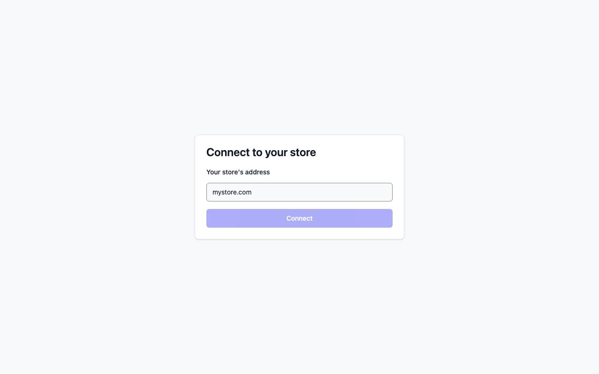 | 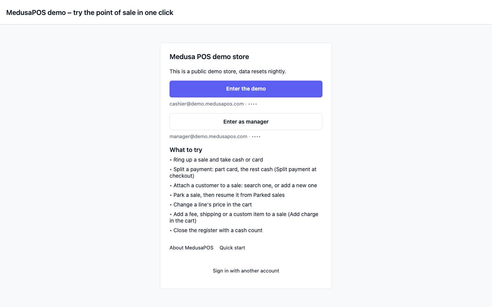 | 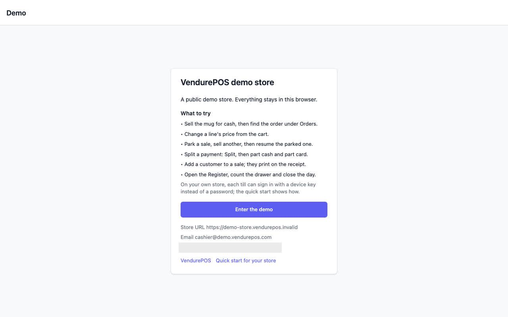 |
| 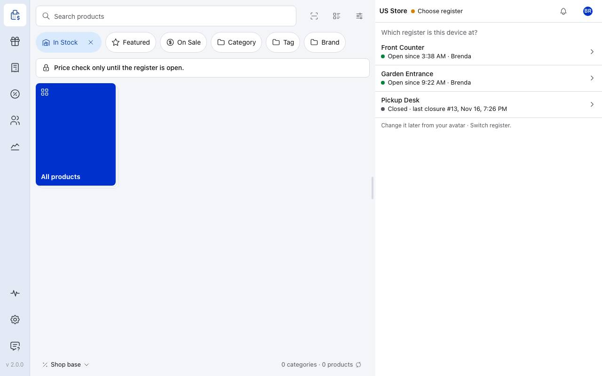 |  | 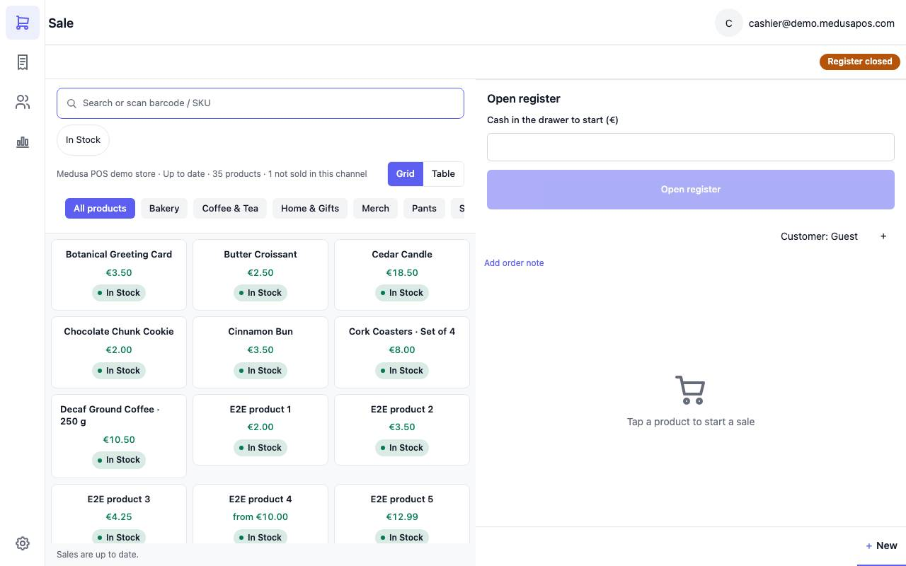 | (one demo store, no pick) |

**Closes it:** PLAN unit 31 (register directory) is merged in core.
`listRegisters()` is not started in any connector. The sign-in itself is
each platform's own.

## Sale screen, wide

**v2:**
- an icon rail;
- products and cart in two columns;
- photo tiles;
- filter pills;
- the QTY/ITEM/PRICE/TOTAL cart table with taxes per rate;
- one "Checkout $X" button;
- open orders as tabs under the cart.

| App | Status | Kind | Fix in | What differs |
|---|---|---|---|---|
| Tally Woo | gap | feature | Tally Woo, `@tallyui/components` | The rail, screen bar and cart header match, but the rail has a fixed width, 640 to 899 px gets the phone layout, taxes always itemise as "Tax n%", and with no outbox the tender reads "Taking payment arrives in the next update" (code read 23 Nov, rows 9, 10, 12, 14, 15, 49, 83, 92, 93). |
| medusapos | gap | visual | medusapos | The shell matches v2 (rail, cart table, Checkout, tabs). The tiles are text only, with no photos. |
| vendurepos | close | visual | `@tallyui/components` | The same shell, with photo tiles. There is a title bar with "Sync now" and "Register ›" over the rail, and the cart column is narrower. |

| v2 | medusapos | vendurepos |
|---|---|---|
| 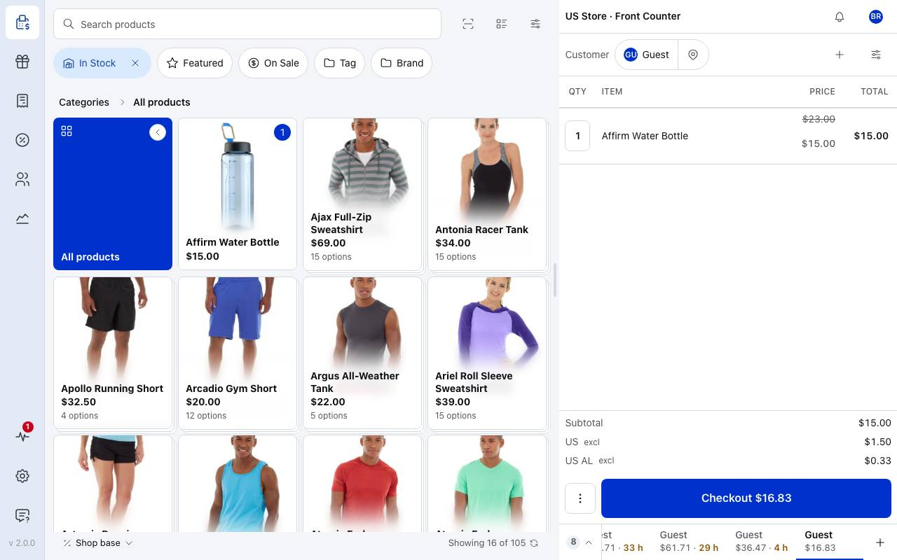 |  |  |

**Closes it:**
- the shell: done (#631, #637, #643, #644, #686, #723, #765–#768,
  #772–#775);
- photos: medusapos maps product thumbnails into its tiles.

## Sale screen, phone

**v2:** at 390 px, products and cart are two bottom tabs, and the cart tab
carries the total.

| App | Status | Kind | Fix in | What differs |
|---|---|---|---|---|
| Tally Woo | gap | visual | Tally Woo | The Products and Cart tab bar and the phone drawer are there; the tab bar has no count animation or haptic (code read 23 Nov, rows 11, 17). |
| medusapos | close | visual | `@tallyui/components` | Products fill the screen, with a "Cart · 1 item €2.50 ›" bar instead of tabs. |
| vendurepos | close | visual | `@tallyui/components` | Products and Cart are tabs at the top, not the bottom. |

| v2 | medusapos | vendurepos |
|---|---|---|
| 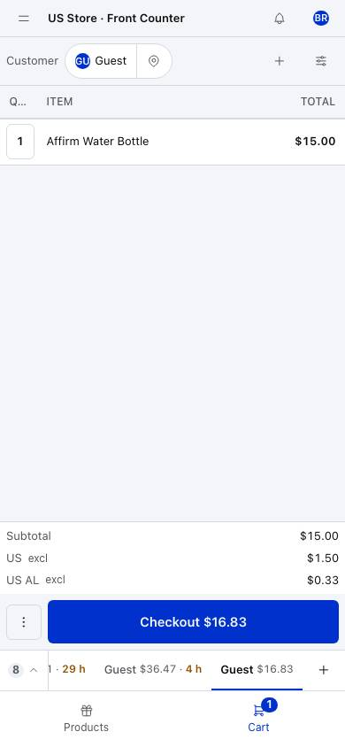 | 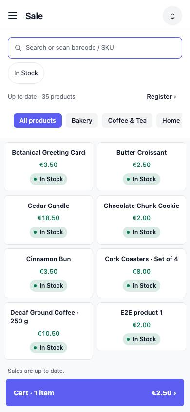 | 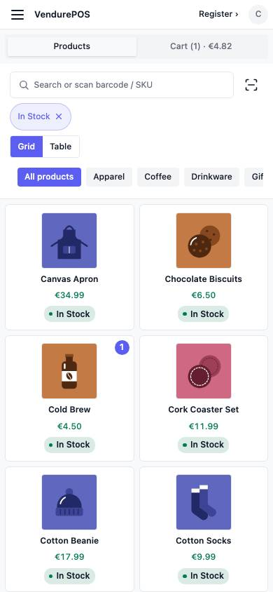 |

**Closes it:** PLAN unit 4 (Scale) is merged. One bottom-tab layout in the
shared shell is `new`.

## Product search and scan

**v2:** one search box with a scan button and filter pills (In Stock,
Featured, On Sale, Category, Tag, Brand); results stay as tiles.

| App | Status | Kind | Fix in | What differs |
|---|---|---|---|---|
| Tally Woo | gap | feature | `@tallyui/components`, Tally Woo | Search and scan work locally, but search has no debounce or meta keys, there is no Featured or Brands pill, an out-of-stock scan is always refused, there is no BLE, and nothing looks the store up when a search or scan misses (row 53 missing) (code read 23 Nov, rows 52, 53, 56, 57, 59, 60, 61, 62, 63). |
| medusapos | close | feature | `@tallyui/components` | "Search or scan barcode / SKU" filters the tiles; only an In Stock pill. |
| vendurepos | close | feature | `@tallyui/components` | The same, plus a scan button; only an In Stock pill. |

| v2 | medusapos | vendurepos |
|---|---|---|
| 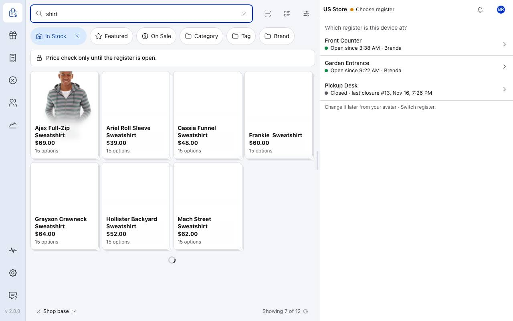 |  |  |

**Closes it:**
- the scanner: done (#692–#734, #825–#828);
- the Featured, On Sale, Tag and Brand pills: `new`. On Woo, the term-feeds
  connector unit carries their data.

## Categories

**v2:** the product column opens on coloured category tiles with a product
count ("Clothing · 160 products"), then a breadcrumb.

| App | Status | Kind | Fix in | What differs |
|---|---|---|---|---|
| Tally Woo | gap | feature | Tally Woo | Browse by categories and tags is there; brands and shortcuts are listed but disabled (row 55 missing) (code read 23 Nov, rows 54, 55). |
| medusapos | gap | visual | medusapos | A row of chips (All products, Bakery, …); no tiles, counts or nesting. |
| vendurepos | gap | visual | vendurepos | The same chips. |

| v2 | medusapos | vendurepos |
|---|---|---|
| 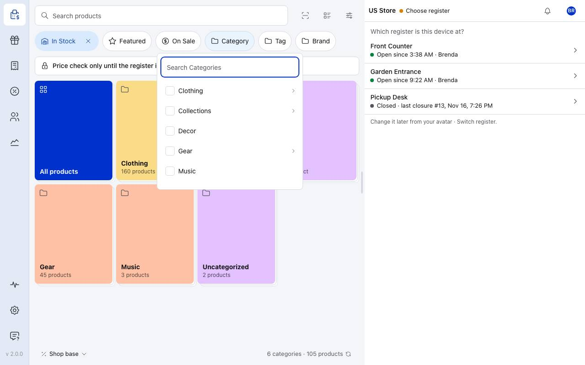 |  | 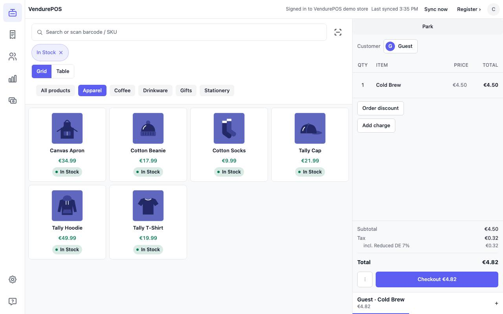 |

**Closes it:** the category browse in components is merged (#823, on #634).
Each app adopts it.

## Variable product

**v2:** the tile drills into the product, with attribute chips (size, colour)
to pick the variation.

| App | Status | Kind | Fix in | What differs |
|---|---|---|---|---|
| Tally Woo | close | visual | Tally Woo | Variations in place, as a popover or as expanded rows, with the attribute picker; look not compared (code read 23 Nov, row 58). |
| medusapos | close | visual | `@tallyui/components` | A "from €10.00" tile opens a list of variants (name, price, stock) over the grid. |
| vendurepos | close | visual | `@tallyui/components` | The same variant list. |

| v2 | medusapos | vendurepos |
|---|---|---|
| 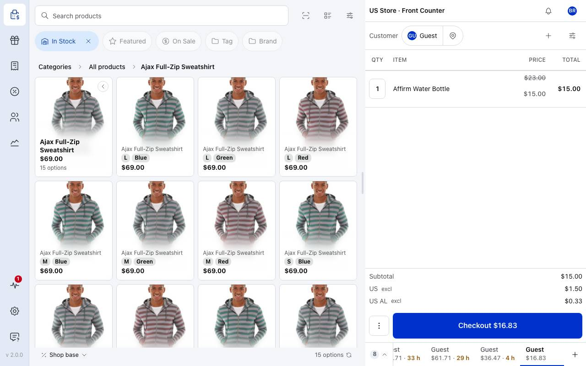 |  | 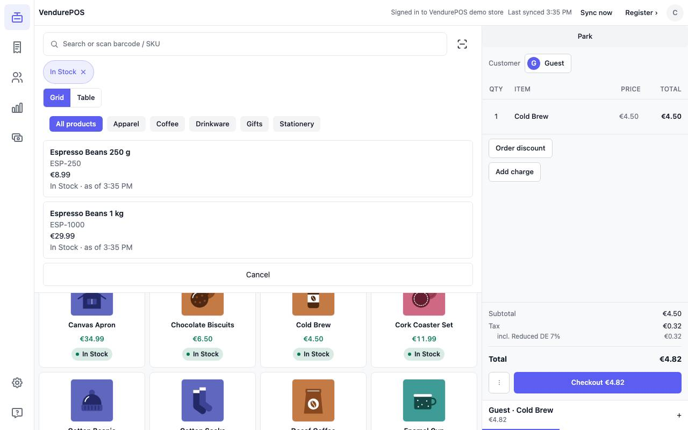 |

**Closes it:** the variations popover (#736) is merged. The attribute chips
are `new` (attributes on the line are #495, needs-paul).

## Cart line: quantity

**v2:** the QTY box opens a keypad beside the line, with − and + and a trash
button.

| App | Status | Kind | Fix in | What differs |
|---|---|---|---|---|
| Tally Woo | gap | feature | `@tallyui/components`, Tally Woo | The quantity keypad and add or split line are there, but a decimal quantity throws and nothing guards against overselling (rows 66, 67 missing) (code read 23 Nov, rows 65, 66, 67, 69). |
| medusapos | close | visual | `@tallyui/components` | A keypad popover with Remove, Apply and Cancel buttons instead of −, + and trash. |
| vendurepos | close | visual | `@tallyui/components` | The same keypad, with Discount added. |

| v2 | medusapos | vendurepos |
|---|---|---|
|  | 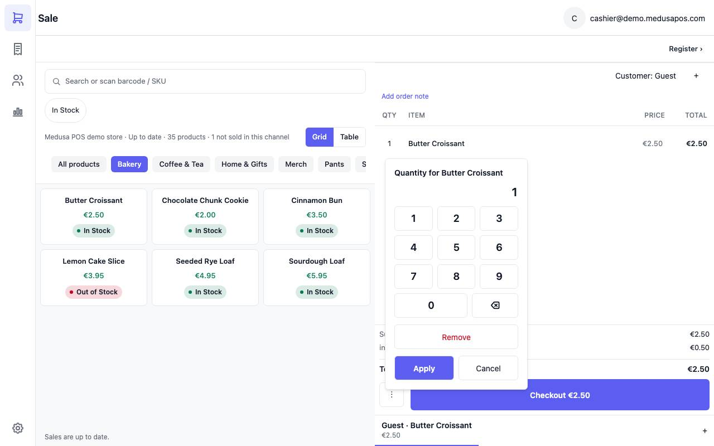 |  |

**Closes it:** the keypad is done. The −, + and trash buttons and dropping
Apply are `new`.

## Cart line: price and discount

**v2:** the price opens a keypad with −5%, −10% and −15%. The keypad applies
as you type, and the old price shows struck through. There is no separate
line-discount form.

| App | Status | Kind | Fix in | What differs |
|---|---|---|---|---|
| Tally Woo | close | visual | `@tallyui/components` | The price keypad with quick-discount keys is the library's line popover; look not compared (code read 23 Nov, row 69). |
| medusapos | close | visual | `@tallyui/components` | The same keypad and quick discounts, plus Discount, Apply and Cancel buttons. |
| vendurepos | close | visual | `@tallyui/components` | The same. |

| v2 | medusapos | vendurepos |
|---|---|---|
| 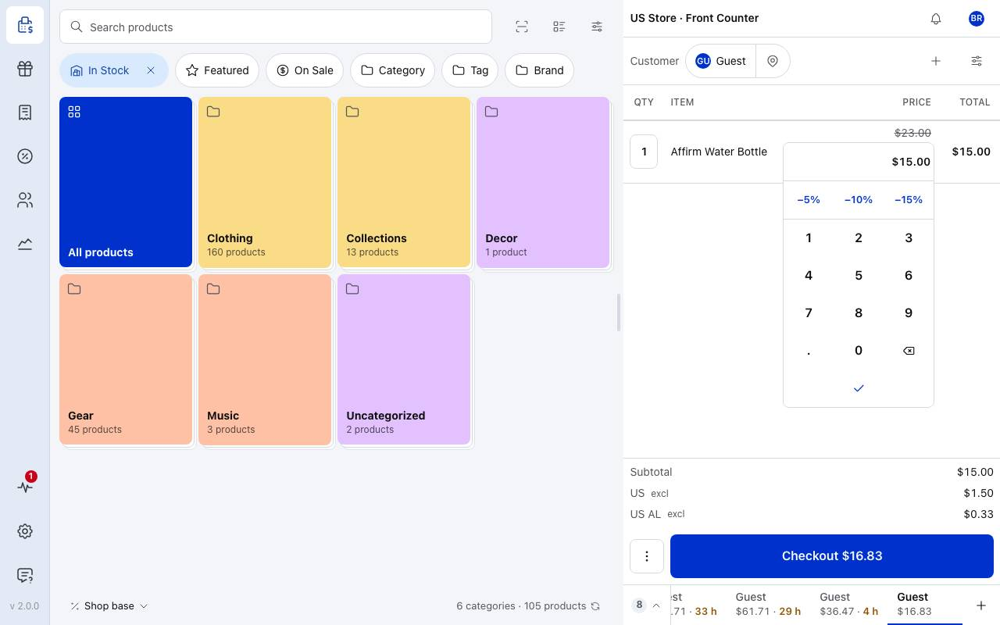 | 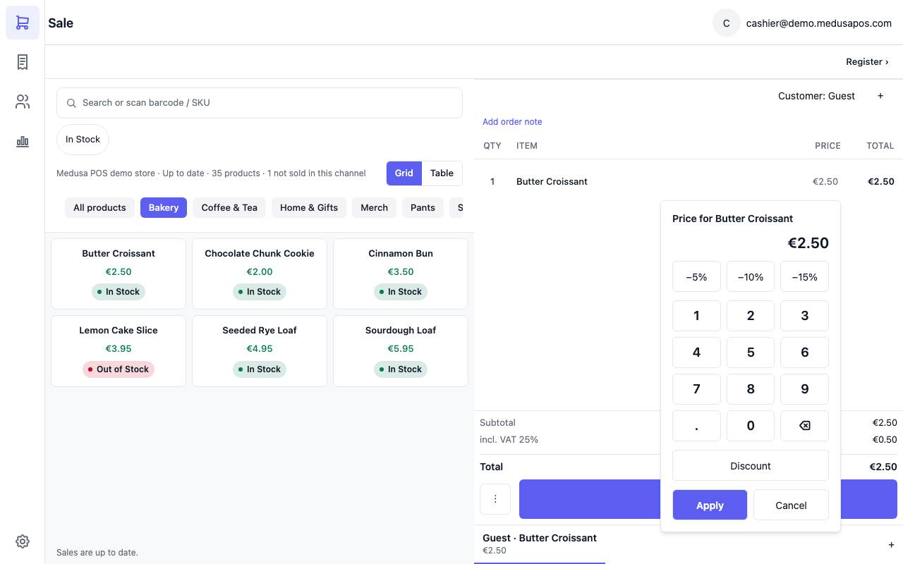 |  |

**Closes it:** the keypad is done. Applying as you type is `new`; see also
[Motion: price keypad over the till](#motion-price-keypad-over-the-till).

## Cart line: edit the whole line

**v2:** swiping a product line open shows Edit and Remove. Edit opens the line
in a record dialog: a form with name, quantity, price and regular price, SKU,
categories and meta, plus a JSON tab
(`pos/cart/cells/edit-cart-item-button.tsx`, `edit-line-item/form.tsx`).

| App | Status | Kind | Fix in | What differs |
|---|---|---|---|---|
| Tally Woo | gap | feature | `@tallyui/components` | `@tallyui/components` has no whole-line editor; its lines edit per cell (quantity and price popovers). |
| medusapos | gap | feature | `@tallyui/components` | The same. |
| vendurepos | gap | feature | `@tallyui/components` | The same. |

**Closes it:** a line record editor in `@tallyui/components`. Not started; no
spec yet. When it is built, Edit joins the product line's swipe strip, which
until then offers Remove only (front desk ruling, 2026-11-26). The per-cell
popovers stay as they are.

## Fee and shipping

**v2:** the cart's "+" menu holds Add new customer, Misc product, Fee,
Discount and Shipping. The fee sheet has a name, an amount in $ or %,
"Amount includes tax" and a tax rate.

| App | Status | Kind | Fix in | What differs |
|---|---|---|---|---|
| Tally Woo | gap | feature | Tally Woo | The add menu is there, but the fee add form has no percent or includes-tax switch, shipping has no method select, and the misc product has no SKU, virtual, downloadable or categories (code read 23 Nov, rows 73, 74, 75, 92). |
| medusapos | gap | feature | medusapos | The "+" menu holds Misc product, Fee, Discount and Shipping. The fee is a small modal with a name and an EUR amount: no %, no tax. |
| vendurepos | close | feature | vendurepos | "Add charge" expands inline (Fee, Shipping, Custom item), with a name, an amount and tax-class chips; no %. |

| v2 | medusapos | vendurepos |
|---|---|---|
|  | 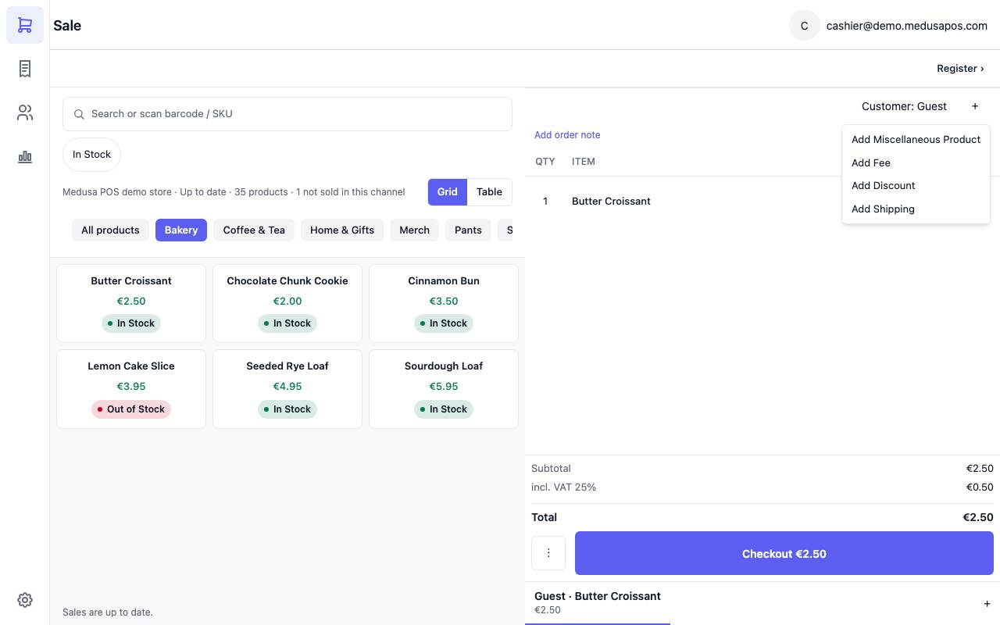 |  |
| 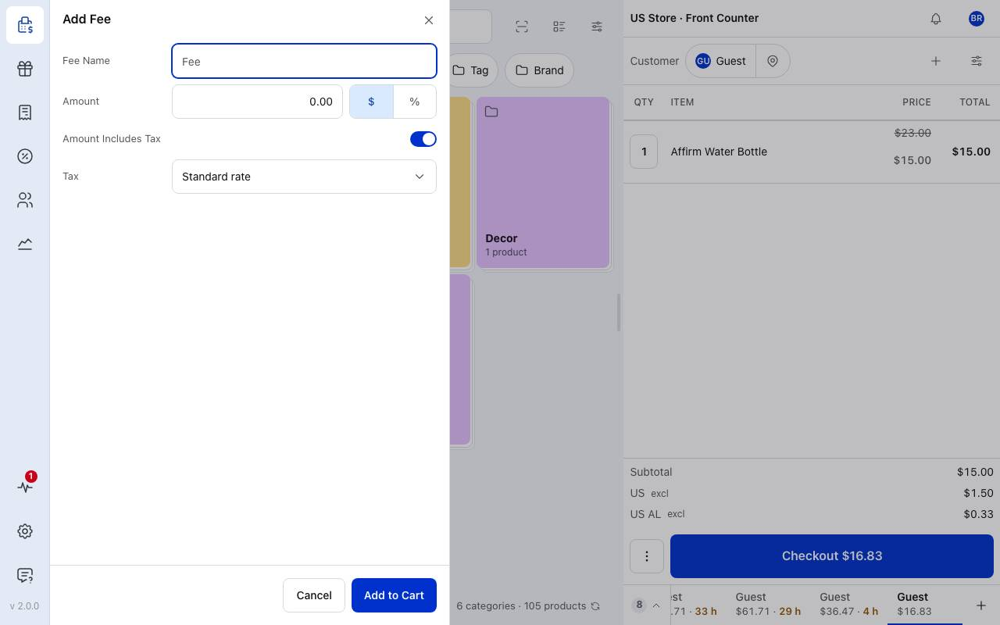 | 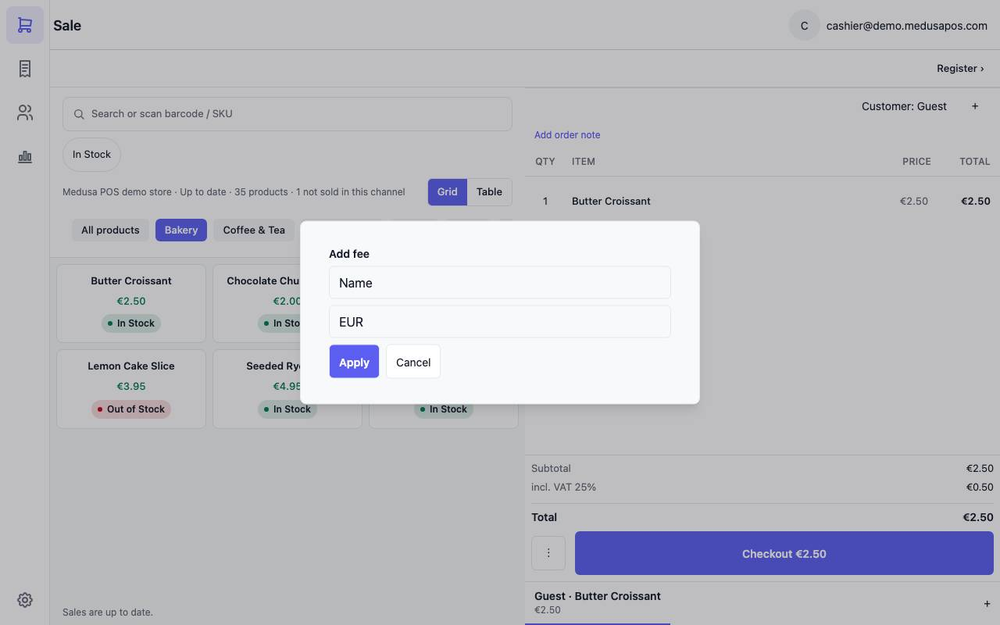 | 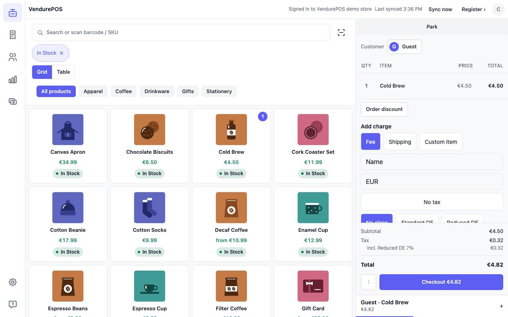 |

**Closes it:** `new` (fee tax and percent in medusapos).

## Coupon

**v2:** "Add Discount" has two tabs, Quick discount and Coupon; the coupon
tab picks from the store's coupons.

| App | Status | Kind | Fix in | What differs |
|---|---|---|---|---|
| Tally Woo | gap | feature | Tally Woo | Coupon validation is faithful, but coupons are picked from synced ones only with no typed code, and the order discount is a library discount, not v2's server coupon line (code read 23 Nov, rows 76, 77). |
| medusapos | gap | feature | medusapos | A Discount entry in the "+" menu; the cart's ⋮ menu holds Void only. No coupon code anywhere. |
| vendurepos | gap | feature | vendurepos | "Order discount" (Percent or Amount) inline; no coupon code. |

| v2 | medusapos | vendurepos |
|---|---|---|
| 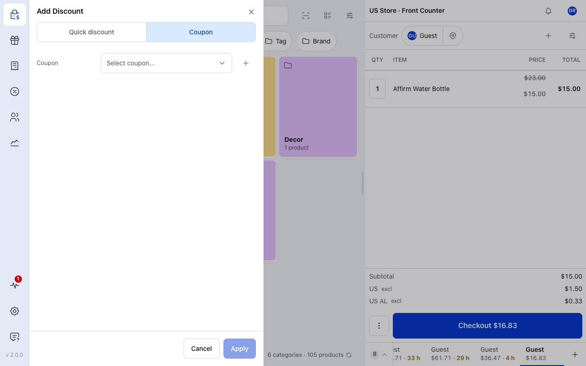 | 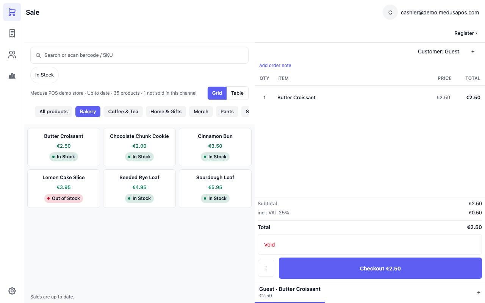 | 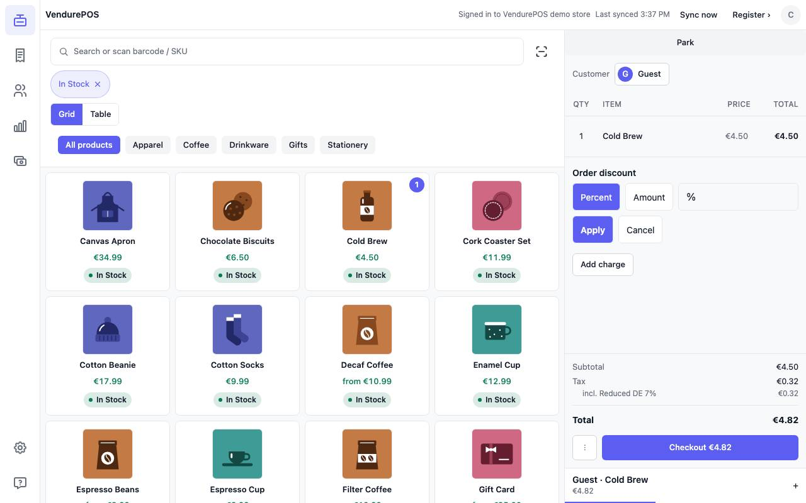 |

**Closes it:**
- shared coupons are merged (#712, #725, #787, #791, #792);
- each app wires its platform's promotions to them (Medusa promotions,
  Vendure coupon codes).

## Customer pick

**v2:** "Customer: Guest" in the cart header opens a search dropdown over the
store's customers, with an address button beside it.

| App | Status | Kind | Fix in | What differs |
|---|---|---|---|---|
| Tally Woo | gap | feature | Tally Woo | Customer search is online only, so no customer can be picked offline, and the cart customer's billing and shipping cannot be edited (row 81 missing) (code read 23 Nov, rows 79, 81). |
| medusapos | close | visual | `@tallyui/components` | "Customer: Guest" opens a modal with a search and "New customer". |
| vendurepos | close | visual | `@tallyui/components` | The search opens inline above the cart, with "New customer". |

| v2 | medusapos | vendurepos |
|---|---|---|
| 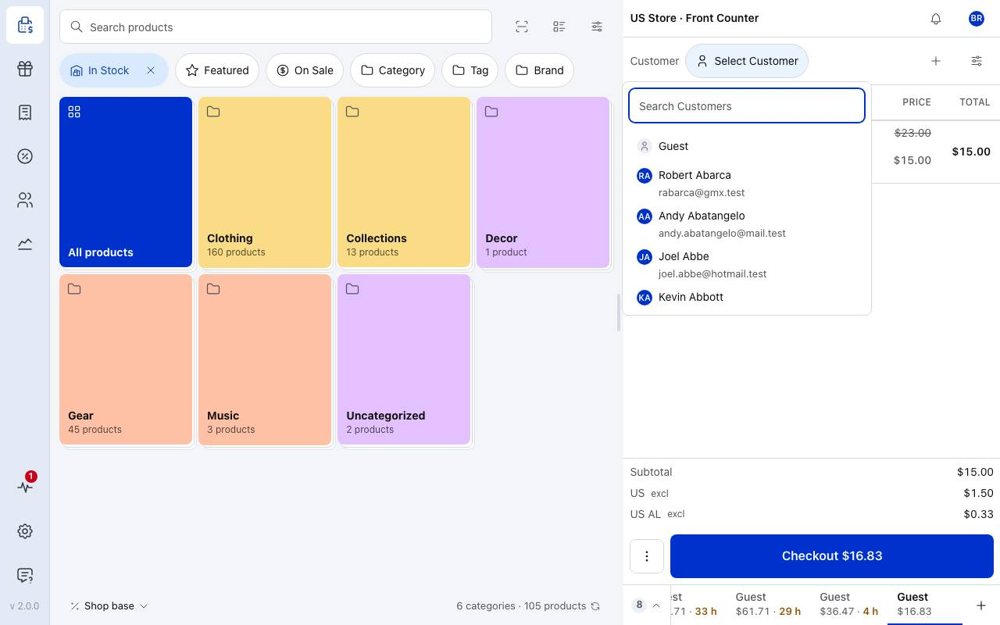 |  |  |

**Closes it:** `new` (one dropdown picker in components).

## Customer create

**v2:** "Add new customer" in the "+" menu opens a full form: name, email,
phone, and billing and shipping addresses.

| App | Status | Kind | Fix in | What differs |
|---|---|---|---|---|
| Tally Woo | gap | feature | Tally Woo | Name, email and phone; no addresses (code read 23 Nov, row 80). |
| medusapos | close | feature | `@tallyui/components` | A "New customer" modal: first and last name, email, phone; no addresses. |
| vendurepos | close | feature | `@tallyui/components` | The same short form, inline. |

| v2 | medusapos | vendurepos |
|---|---|---|
|  |  | 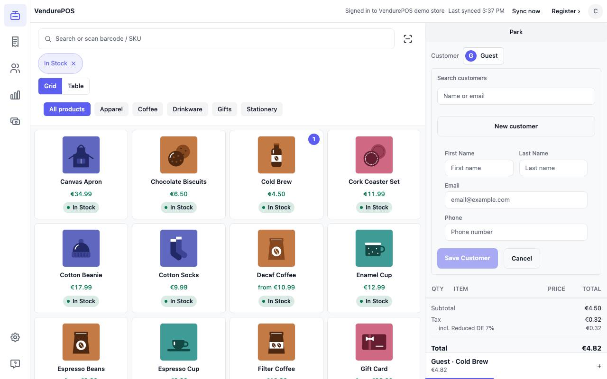 |

**Closes it:** PLAN unit 7 (`updateCustomer` with addresses) is merged, as
are its connector units (#611, #613, #614). The address fields in the form
are `new`.

## Cart note

**v2:** the cart's Order details sheet holds:
- a customer note;
- the hand-over block (status, cashier, store, register);
- tax exempt and hidden fields;
- Void, Close, Print and Sync order.

| App | Status | Kind | Fix in | What differs |
|---|---|---|---|---|
| Tally Woo | gap | feature | Tally Woo | The order note is there, but the Order details sheet holds Note, Void, Print and Close only, with no hand-over or custom fields, no tax exempt and no save to the server (rows 85, 88 missing) (code read 23 Nov, rows 85, 86, 87, 88). |
| medusapos | close | feature | medusapos | An "Order note" field over the cart lines; no hand-over, tax exempt or sync. |
| vendurepos | missing | feature | vendurepos | "Order details" holds only Void and Close; no note. |

| v2 | medusapos | vendurepos |
|---|---|---|
|  |  |  |

**Closes it:**
- PLAN unit 6 and the cart note row (#820) are merged, and vendurepos adopts
  them;
- the hand-over block and tax exempt are `new`.

## Park and open orders

**v2:** every open sale is a tab under the cart ("Guest $16.83 · 5 h"), with
a count and a "+" for a new one.

| App | Status | Kind | Fix in | What differs |
|---|---|---|---|---|
| Tally Woo | gap | feature | Tally Woo | Tabs, ages and a new order are there, but open orders are local to this device, with no server pos-open orders (code read 23 Nov, row 89). |
| medusapos | close | visual | `@tallyui/components` | Tabs under the cart with a "+", plus a parked-sales chip; no ages. |
| vendurepos | close | visual | `@tallyui/components` | Tabs under the cart plus "Parked (1)" over the cart. |

| v2 | medusapos | vendurepos |
|---|---|---|
|  | 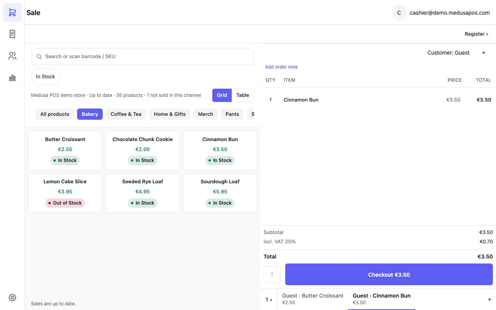 |  |

**Closes it:** done (PLAN unit 19). The tab ages are `new`.

## Tender

**v2:**
- the tender pane replaces the products column: Payments and Legacy tabs, a
  "TO PAY" headline with Split, method tiles, quick-cash chips, a keypad and
  "Take $16.83 in Cash";
- the cart side becomes a payments ledger;
- the sale completes when it is paid.

| App | Status | Kind | Fix in | What differs |
|---|---|---|---|---|
| Tally Woo | gap | feature | Tally Woo, `@tallyui/connector-woocommerce` | The cash keypad, quick-cash chips, change and slow-save notice are there, but the tender is two hard-coded tiles (cash and a typed card reference), with no store gateways, order-pay webview, readers, tips or pay later, no rounded due at 4.2.0, and a hard-coded order status (rows 95, 96, 103, 104, 106, 110 missing) (code read 23 Nov, rows 95, 96, 97, 98, 99, 100, 101, 102, 103, 104, 106, 110, 112, 113, 114). |
| medusapos | gap | visual | `@tallyui/components` | Tender sits inside the cart column: Cash and Card terminal, chips, a keypad, "Take", then a separate "Complete sale" and Back. There is no ledger beyond "No payments yet". |
| vendurepos | gap | visual | `@tallyui/components` | The same pane across the full width. |

| v2 | medusapos | vendurepos |
|---|---|---|
|  | 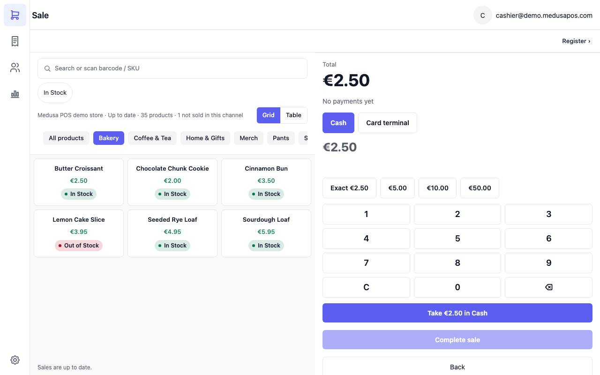 | 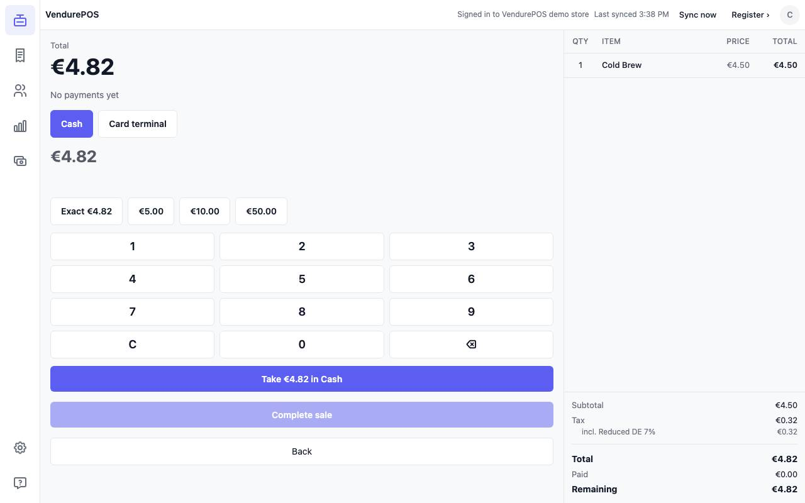 |

**Closes it:** PLAN units 14, 15, 16 and 17 are merged: legs, rounding, the
keypad and chips, and the driver. Unit 18 (terminal leg view) is not
started. v2's layout is in `@tallyui/components`, for the apps to adopt:
- the pane over the products column: `POSLayout`'s `renderCheckout`
  (`packages/components/src/layout/pos-layout.tsx:42`);
- the cart as the ledger: `TenderLedger`'s `closing` mode
  (`packages/components/src/sale/tender-ledger.tsx:39`).

Still open: the sale completing when paid (`TenderPane` keeps a Complete sale
step), and unit 18.

## Split payment

**v2:** "Split" on the TO PAY headline. Each payment is a leg in the ledger,
and a leg can be voided.

| App | Status | Kind | Fix in | What differs |
|---|---|---|---|---|
| Tally Woo | gap | feature | Tally Woo, `@tallyui/connector-woocommerce` | Split by ways and by percent is there, but the ledger needs a store that reports `order_payments_list`, a cancelled payment is only written to a local journal, and split by items is not mounted (row 109 missing) (code read 23 Nov, rows 107, 108, 109, 111). |
| medusapos | missing | feature | `@tallyui/components` | There is no Split control on the tender pane. |
| vendurepos | missing | feature | `@tallyui/components` | There is no Split control, although the demo card says "Split a payment". |

| v2 | medusapos | vendurepos |
|---|---|---|
|  | (no split control) | (no split control) |

**Closes it:** PLAN units 14 (payment legs) and 16 are merged, but neither
demo shows a split. Adopt it in each app, or add a Split entry to the
shared pane if the merged pane lacks one (`new`).

## Receipt and print

**v2:** a Receipt sheet with a template choice, a printer, a preview, Email,
Download PDF and Print.

| App | Status | Kind | Fix in | What differs |
|---|---|---|---|---|
| Tally Woo | gap | feature | Tally Woo, `@tallyui/components` | Store templates, zoom, email with its offline queue and order sync are there, but every print is the browser dialog, with no printer switcher, PDF or real printer output, and no logo or QR outside store templates (rows 118, 120, 126 missing) (code read 23 Nov, rows 116, 117, 118, 119, 120, 121, 122, 123, 124, 125, 126). |
| medusapos | gap | feature | `@tallyui/components` | A centred card with "Email receipt", "Print receipt" and "New sale". No preview, template or PDF. |
| vendurepos | gap | feature | `@tallyui/components` | A receipt in the cart column with "Print receipt" and "New sale". No email, template or PDF. |

| v2 | medusapos | vendurepos |
|---|---|---|
|  | 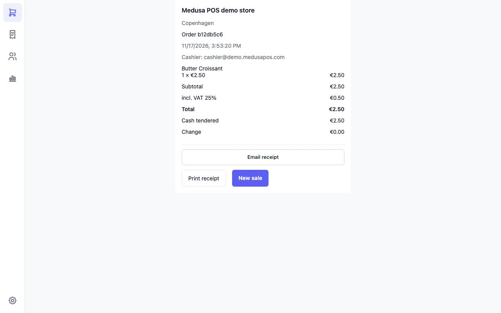 |  |

**Closes it:**
- PLAN unit 28 is partly done (#609: no refund, Z or report defaults); 29 and
  38 are merged, but neither app offers a template or a printer;
- `ReceiptSheet` (`packages/components/src/sale/receipt-sheet.tsx`) has the
  template and printer rows, the preview, email and Download PDF, and
  ESC/POS printing is in `packages/pos/src/print/escpos`: the apps adopt them;
- the Medusa `emailReceipt` connector unit (not started).

## Orders list

**v2:** a table of the store's orders. Filters: status, payment method,
customer, cashier, store, register and date. It pages through the server's
history.

| App | Status | Kind | Fix in | What differs |
|---|---|---|---|---|
| Tally Woo | gap | feature | Tally Woo, `@tallyui/components` | A table with day headings, paging, search, scan and tap-to-filter, but fetched online a page at a time, with six columns, no payment-method or register pill and no sort (row 144 missing) (code read 23 Nov, rows 142, 143, 144, 145, 146, 147, 148, 149). |
| medusapos | gap | feature | medusapos | A "Recent" card list of this till's sales only ("No sales yet" until one is made). |
| vendurepos | close | feature | vendurepos | An "All orders / This till" table with Status, Customer, Cashier, register and Date filters. There is no payment-method filter. |

| v2 | medusapos | vendurepos |
|---|---|---|
|  |  | 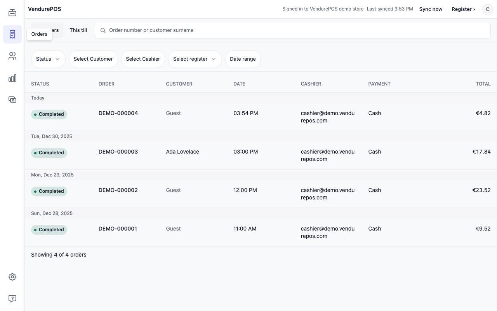 |

**Closes it:**
- medusapos: adopt the Medusa `listOrders` connector unit, merged in
  9dc9ce38 (#540, ADR-081; `connectors/medusa/src/orders.ts:313`);
- vendurepos: done (#595).

## Order detail

**v2:** a side sheet with View, Edit and JSON tabs: lines, totals and
payments, plus Delete, Refund, Sync, Close, Receipt and Re-open.

| App | Status | Kind | Fix in | What differs |
|---|---|---|---|---|
| Tally Woo | gap | feature | Tally Woo | The View tab shows items, totals, payments, refunds and the customer, with print and per-order sync, but there is no Edit or JSON tab and no re-open, delete, invoice actions or edit (rows 154, 155, 156, 157 missing) (code read 23 Nov, rows 130, 150, 151, 152, 153, 154, 155, 156, 157, 158). |
| medusapos | missing | feature | medusapos | A "Recent" card does not open. |
| vendurepos | close | feature | vendurepos | A full page with lines, totals and paid, "Refund items", "Receipt" and "Back to orders". No Re-open or Sync. |

| v2 | medusapos | vendurepos |
|---|---|---|
| 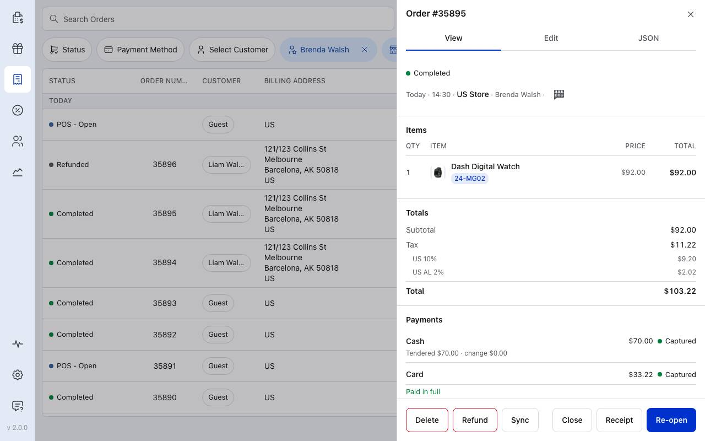 |  | 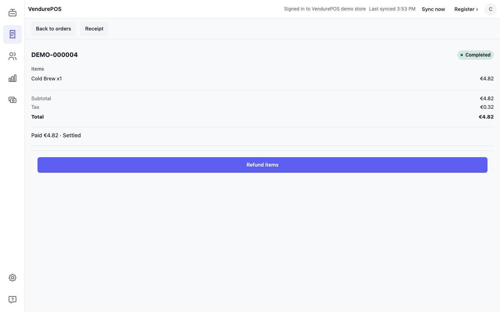 |

**Closes it:**
- PLAN unit 20, and the Medusa `listOrders` unit;
- Re-open is ADR-090 (#833–#852, open #853).

## Refund

**v2:** a refund sheet: quantity per line, a custom amount, a reason, and
Process Refund.

| App | Status | Kind | Fix in | What differs |
|---|---|---|---|---|
| Tally Woo | missing | feature | Tally Woo, `@tallyui/connector-woocommerce` | The app imports no refund code, though the library has the form, and the connector has no refund write; only refunded orders display (code read 23 Nov, rows 131, 132, 133). |
| medusapos | missing | feature | medusapos | There is no order to refund from. |
| vendurepos | close | feature | vendurepos | Inline on the order page: a quantity per item, a restock switch, a reason, Refund and Cancel. There is no custom amount. |

| v2 | medusapos | vendurepos |
|---|---|---|
| 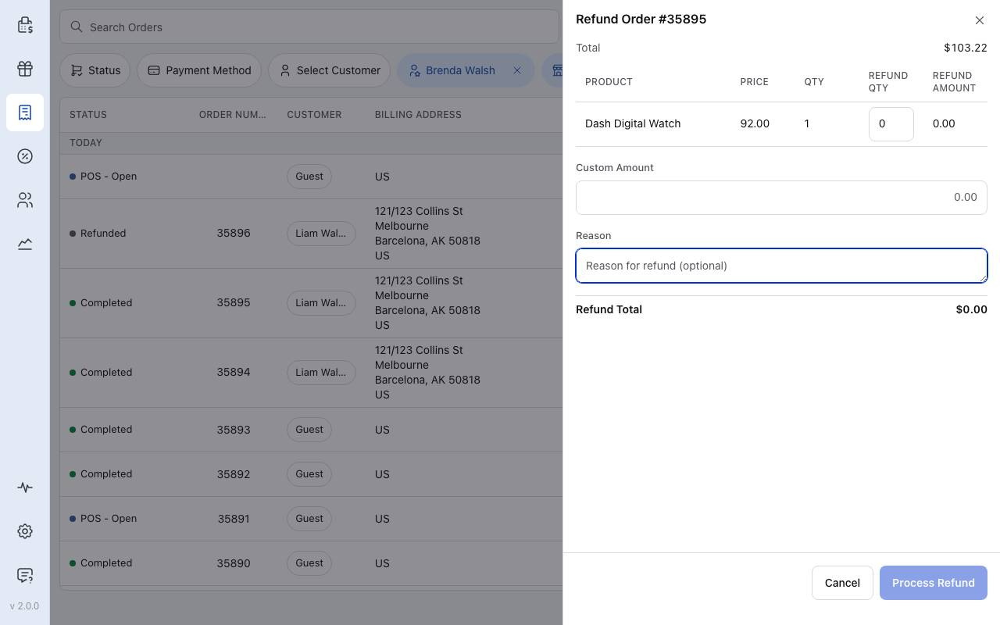 | (no refund control) | 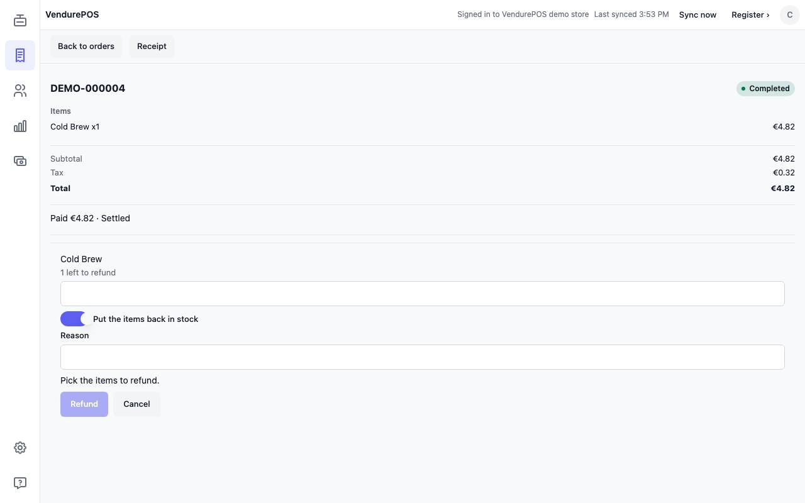 |

**Closes it:** PLAN units 9, 20 and 21 are merged. medusapos needs its
orders (`listOrders`) first.

## Customers

**v2:** a Customers screen in the rail: a searchable table (name, email,
billing address, date created) and an add button.

| App | Status | Kind | Fix in | What differs |
|---|---|---|---|---|
| Tally Woo | gap | feature | Tally Woo | A customers table with server search and an add form, but one server page only, fewer columns, a four-field add form, and rows that cannot be opened or edited (row 170 missing) (code read 23 Nov, rows 167, 168, 169, 170, 171). |
| medusapos | gap | feature | medusapos | A Customers screen that stays empty until a search, plus "Add customer". |
| vendurepos | close | feature | vendurepos | A customers table with search (#822). |

| v2 | medusapos | vendurepos |
|---|---|---|
|  | 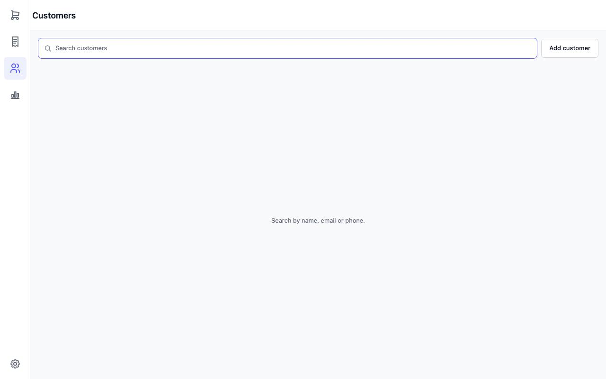 |  |

**Closes it:**
- vendurepos: done (#822);
- medusapos: lists the store's customers on open, `new`.

## Products

**v2:** a Products screen in the rail: a table with stock, a manage-stock
switch, variations and prices, edited in place.

| App | Status | Kind | Fix in | What differs |
|---|---|---|---|---|
| Tally Woo | gap | feature | Tally Woo | A read-only products table with search, scan and count, but no inline price, sale price or stock edit and no edit dialog, with fewer columns, sorts and filter chips (rows 160, 161, 162 missing) (code read 23 Nov, rows 159, 160, 161, 162, 163, 164, 165, 166). |
| medusapos | gap | feature | `@tallyui/components` | Only the sale screen's "Table" view, read-only. |
| vendurepos | gap | feature | `@tallyui/components` | The same read-only table view. |

| v2 | medusapos | vendurepos |
|---|---|---|
| 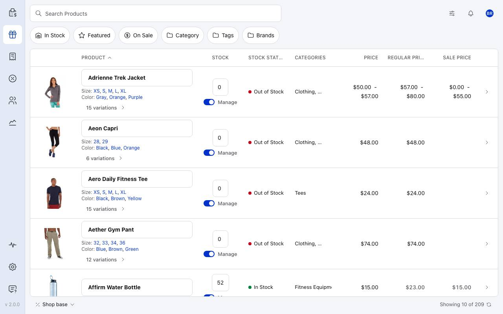 | 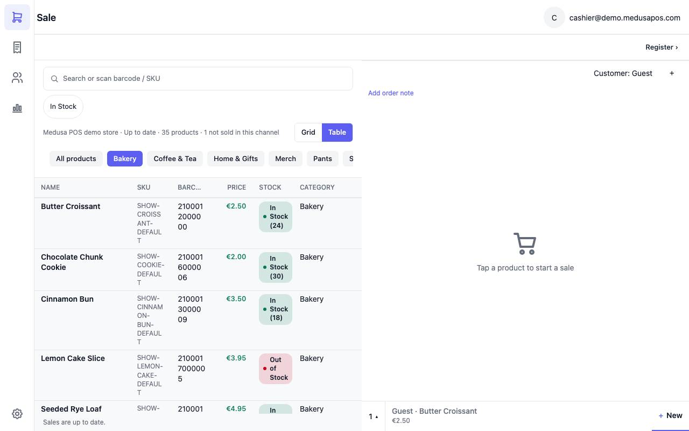 | 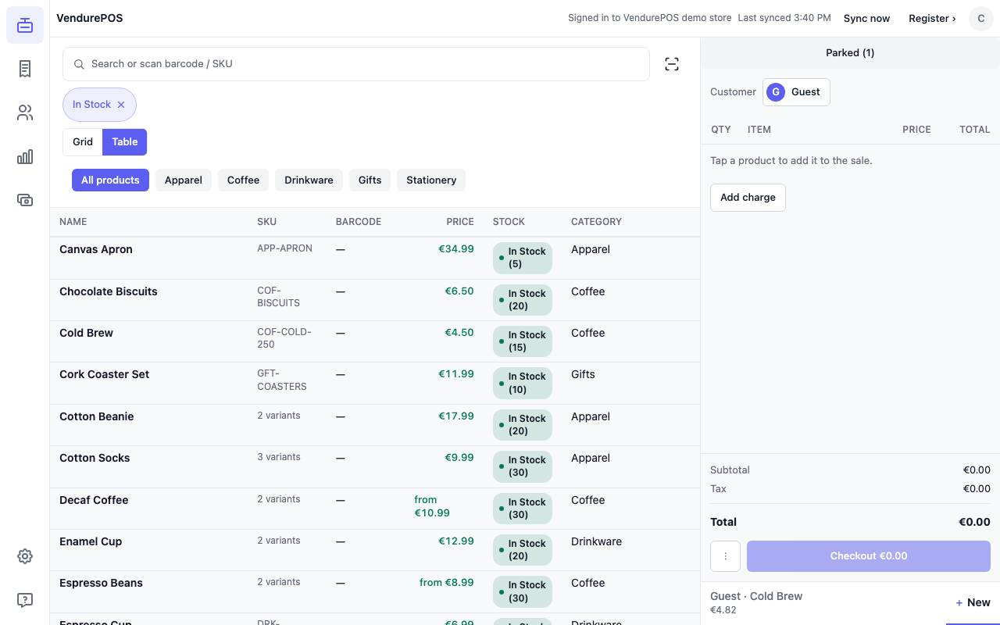 |

**Closes it:** `new` (a products screen; stock edits are each platform's own
API).

## Register: open, cash in and out

**v2:** the register side sheet: the drawer total, Paid in, Paid out, No
sale, the expected cash, Print X-report and Close register.

| App | Status | Kind | Fix in | What differs |
|---|---|---|---|---|
| Tally Woo | gap | feature | Tally Woo | Open with a float and paid in, paid out and no sale are the library's, but the panel is a centred dialog with no Print X-report, and no sale opens no drawer (row 129 missing) (code read 23 Nov, rows 129, 135, 136, 137). |
| medusapos | match | visual | | The same side sheet: drawer total, session sales, Paid in, Paid out, No sale, float, expected, Print X-report, Close register. |
| vendurepos | match | visual | | The same side sheet. |

| v2 | medusapos | vendurepos |
|---|---|---|
| 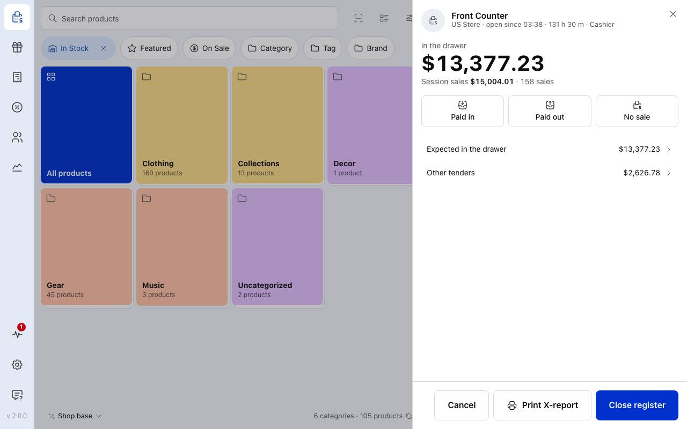 | 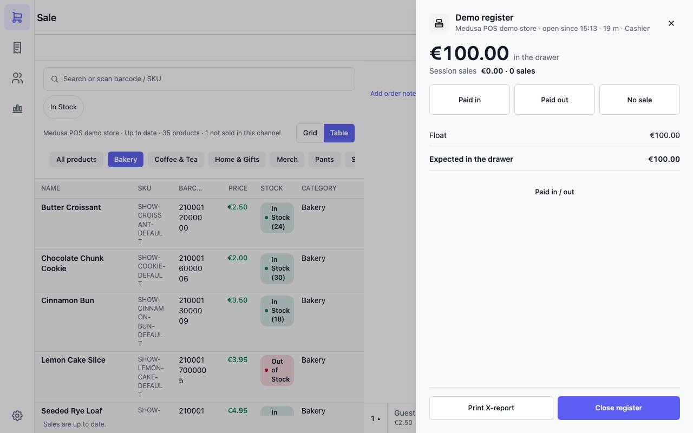 | 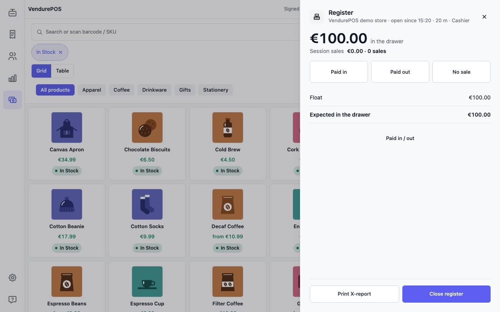 |

**Closes it:** done (#735). v2's "Other tenders" line is the only extra.

## Register close (X and Z)

**v2:** the close sheet: a keypad cash count, a note, "Count by notes and
coins", and "Close & print".

| App | Status | Kind | Fix in | What differs |
|---|---|---|---|---|
| Tally Woo | gap | feature | Tally Woo | The denomination count with over and short and session sync are there, but a close over the variance threshold is refused with nowhere to approve, and closures have no recount (row 139 missing) (code read 23 Nov, rows 138, 139, 140, 141). |
| medusapos | close | visual | `@tallyui/components` | A grid of notes and coins first, with "Back to selling" and "Close register"; no keypad-first count. |
| vendurepos | close | visual | `@tallyui/components` | The same count. |

| v2 | medusapos | vendurepos |
|---|---|---|
| 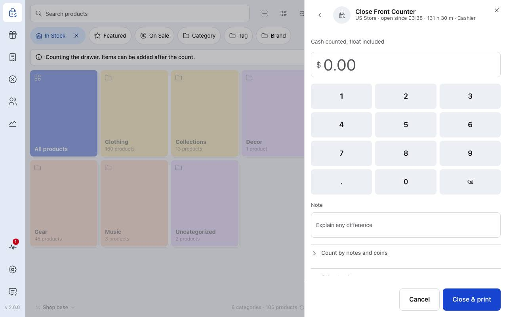 | 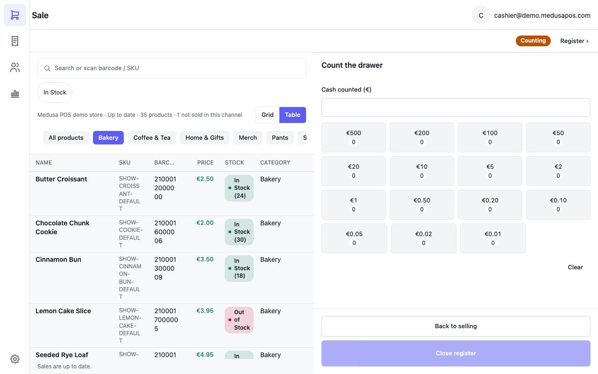 | 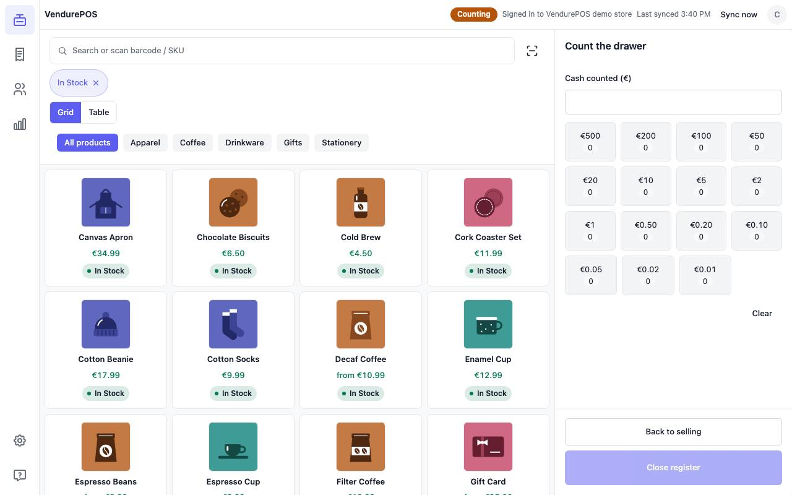 |

**Closes it:** PLAN unit 13 (manager approval) is merged. Units 32 (recount)
and 27 (closures) are not started. The keypad-first count is `new`.

## Reports

**v2:** a Reports screen: a hero total, a sales chart, Orders, Payments and
Where-sold cards, and Print summary.

| App | Status | Kind | Fix in | What differs |
|---|---|---|---|---|
| Tally Woo | gap | feature | Tally Woo | Periods, presets, compare and the hourly chart are there, but reports cover this device only, count rejected and pending sales, subtract no refunds, and have no Brands or Refunds cards or panels (code read 23 Nov, rows 176, 177, 178, 179, 180). |
| medusapos | close | visual | `@tallyui/components` | The same layout of hero and cards, with fewer cards. |
| vendurepos | close | visual | `@tallyui/components` | The same. |

| v2 | medusapos | vendurepos |
|---|---|---|
|  |  | 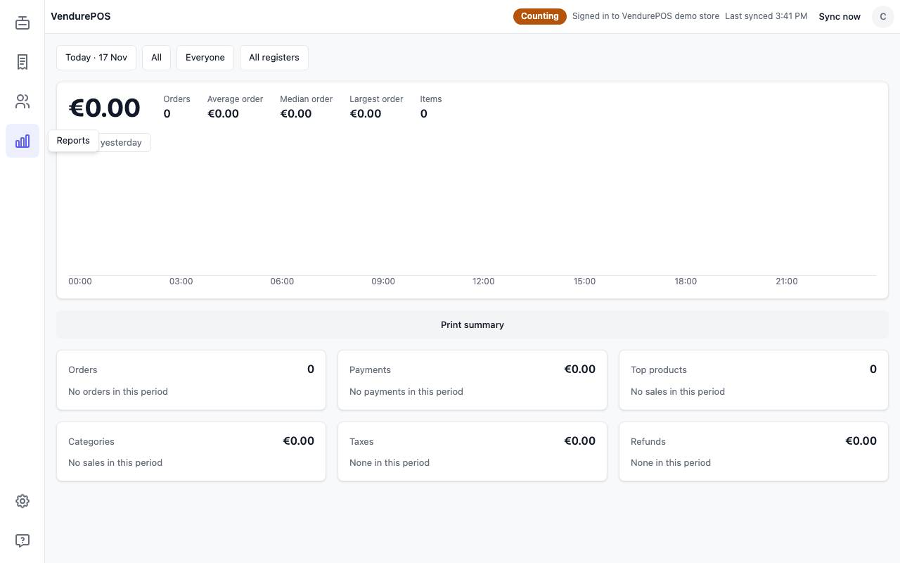 |

**Closes it:** PLAN unit 25 is done; units 26 and 27 remain.

## Settings: display, theme and scale

**v2:** Settings › Theme: ten themes, Scale, and icon sets.

| App | Status | Kind | Fix in | What differs |
|---|---|---|---|---|
| Tally Woo | gap | visual | Tally Woo | Light, dark and system, ten themes, fonts and Scale are there; there is no icon-set choice (code read 23 Nov, rows 19, 20). |
| medusapos | close | visual | medusapos | Theme with the ten themes; no Scale or icon set. |
| vendurepos | close | visual | vendurepos | General (prices, quick discounts, products per row) and Theme; no Scale. |

| v2 | medusapos | vendurepos |
|---|---|---|
| 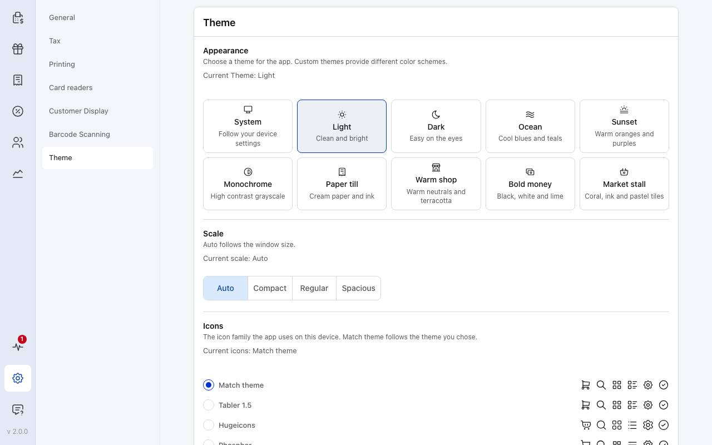 | 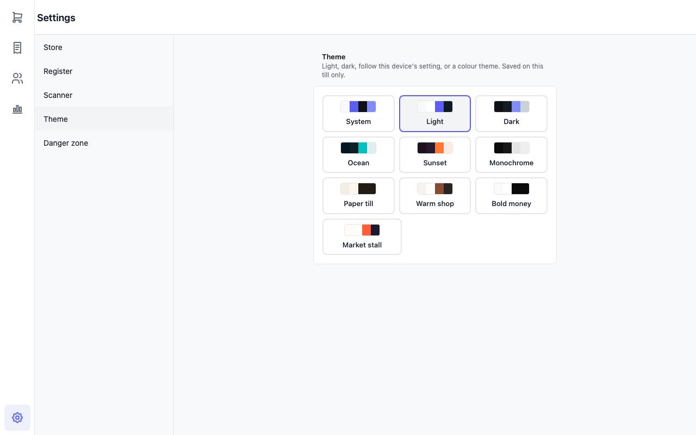 |  |

**Closes it:** PLAN unit 22 (on 3, 4 and 5) is merged. Each app adopts the
Scale section.

## Settings: printers

**v2:** Settings › Printing: printers, paper width, auto-print and receipt
templates.

| App | Status | Kind | Fix in | What differs |
|---|---|---|---|---|
| Tally Woo | gap | feature | Tally Woo | Network printer profiles and a printer per template are saved, then never used at print, with no code page, columns or cut; auto print opens the browser dialog, and there is no discovery, test print or setup report (row 128 missing) (code read 23 Nov, rows 124, 127, 128). |
| medusapos | missing | feature | `@tallyui/components` | Settings has Store, Register, Scanner, Theme and Danger zone; no printing. |
| vendurepos | gap | feature | `@tallyui/components` | Printing holds one "Print after each sale" switch. |

| v2 | medusapos | vendurepos |
|---|---|---|
| 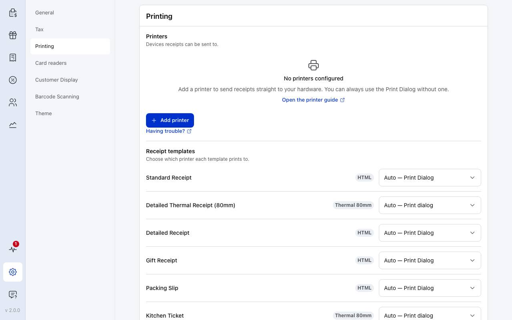 | (no section) |  |

**Closes it:** PLAN units 29 (print transport) and 38 (ESC/POS) are merged.
A Printing settings section with printers and templates is `new`.

## Settings: barcode

**v2:** Settings › Barcode Scanning: the key-timing threshold, minimum
length, prefix and suffix, sound, direct connection, and a test field.

| App | Status | Kind | Fix in | What differs |
|---|---|---|---|---|
| Tally Woo | gap | feature | Tally Woo | Thresholds, prefix, suffix, sound and the test panel are there; no BLE, keyboard register flow, device chooser or reset notice (code read 23 Nov, row 42). |
| medusapos | close | feature | `@tallyui/components` | Scanner: average time per key, minimum characters and a test field; no prefix, suffix or sound. |
| vendurepos | close | feature | `@tallyui/components` | Scanner: minimum length, prefix, suffix, sounds and a test field; no key timing. |

| v2 | medusapos | vendurepos |
|---|---|---|
|  | 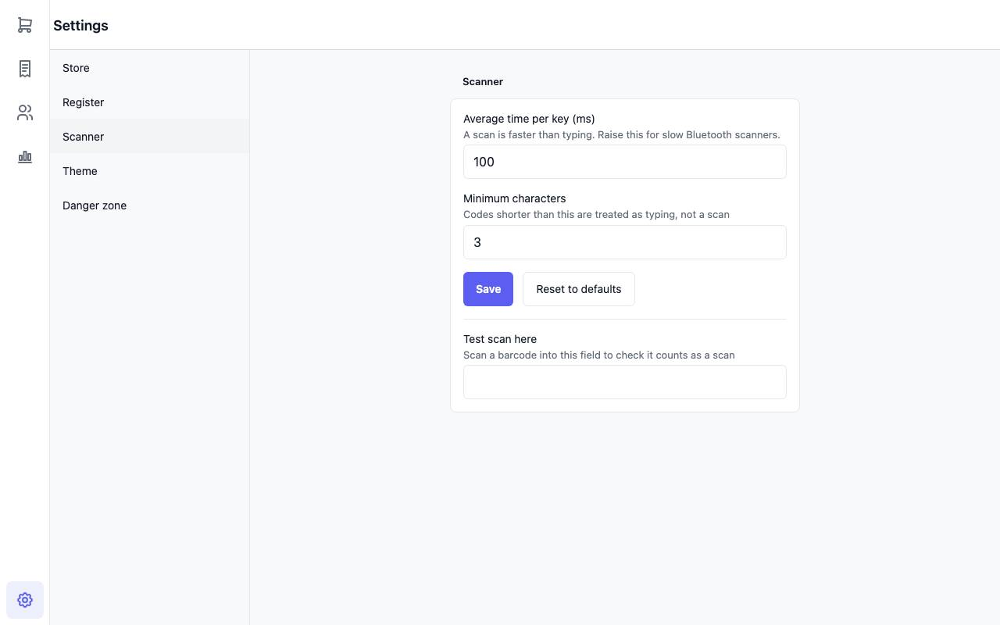 |  |

**Closes it:** PLAN unit 39 (barcode settings section and test panel) is
not started. The shared scanner rules are merged (#825–#827).

## Cashier switch and sign-out

**v2:** the avatar opens a user sheet:
- sales today;
- "Hand the till to" another cashier;
- the store switch;
- Sign out.

| App | Status | Kind | Fix in | What differs |
|---|---|---|---|---|
| Tally Woo | gap | feature | Tally Woo | Sales today, the drawer, "Hand the till to" and Sign out are there, but there is no store or register switch or open-carts count, though the library sheet has those rows (row 6 missing) (code read 23 Nov, rows 5, 6). |
| medusapos | close | feature | medusapos | Sales today, the drawer, "Hand the till to the next cashier" and Sign out; no store switch. |
| vendurepos | gap | feature | vendurepos | The email, the store and Sign out only. |

| v2 | medusapos | vendurepos |
|---|---|---|
|  |  |  |

**Closes it:** the shared sheet is ready-queue row S9: `CashierSheet` (S9a,
#982) has the header, Your sales today and Sign out, and now also "Hand the
till to" (530744b7) and the Store and Register rows with Switch
(bef8aebb). PLAN unit 33 is the handover slip and switch confirm, not the
sheet. vendurepos adopts the sheet (`cashier()` is not started in any
connector).

## Offline

**v2:** with the network gone, a "Device went offline" toast and an Offline
pill; search and sales carry on.

| App | Status | Kind | Fix in | What differs |
|---|---|---|---|---|
| Tally Woo | close | visual | Tally Woo | The online, offline and unreachable toasts, the pill and the session hold banner are there (code read 23 Nov, rows 23, 24). |
| medusapos | gap | feature | `@tallyui/components` | Search carries on, but nothing says the till is offline: the footer keeps "Sales are up to date". |
| vendurepos | gap | feature | `@tallyui/components` | The same; no indicator. |

| v2 | medusapos | vendurepos |
|---|---|---|
|  |  |  |

**Closes it:** the shared pieces exist for the apps to adopt:
- the "Device went offline" toast (`packages/components/src/shell/connectivity-toast.tsx`);
- the RegisterBar's Offline pill (`packages/components/src/register/register-bar.helpers.ts:64`).

PLAN unit 34 is still open: 34a is partly done (#636; no connector reports a
lost response to the tracker), and 34b and 34c are not started. Unit 23
(outbox health) is merged.

---

## Motion

v2 animates with Reanimated: springs, layout entering and exiting, and
skeletons. TallyUI's `packages/components/src` animates with React Native's
`Animated` instead (no Reanimated):
- shared timings and springs in `lib/motion.ts`, and sheet and dialog motion
  in `ui/dialog/motion.ts`;
- cart rows in `cart/cart-row-motion.tsx` and `cart/cart-line-strip.tsx`;
- the column crossfade in `layout/pos-layout.tsx`, and the tile badge in
  `product/in-cart-badge.tsx`;
- a `Skeleton` (`ui/skeleton`), used in `product/product-table.tsx`.

The rows below name the shared work still open; the rest is adoption in each
app. Any motion added honours the platform's reduce-motion setting, as v2's
does.

Each clip is shown v2 | medusapos | vendurepos.

### Motion: product tile press and add

**v2:** a press on the tile adds the line. The tile gets a count badge, and
an "added to cart" toast slides in.

| App | Status | Kind | Fix in | What differs |
|---|---|---|---|---|
| Tally Woo | not reachable | motion | | No table row states this animation's presence or absence in code (code read 23 Nov, no covering row). |
| medusapos | gap | motion | `@tallyui/components` | No press state, no count badge, no toast; the line just appears. |
| vendurepos | gap | motion | `@tallyui/components` | A count badge and a toast; no press state. |

| v2 | medusapos | vendurepos |
|---|---|---|
|  |  |  |

### Motion: cart line enter and leave

**v2:** the source shows lines that can be swiped, peeked with a spring and
flown off on removal (`pos/cart/cells/line-strip.tsx:177-261`, reduce-motion
aware). Open-order tabs fade in and out (`pos/cart/tabs.tsx:127, 446`).

| App | Status | Kind | Fix in | What differs |
|---|---|---|---|---|
| Tally Woo | not reachable | motion | | No table row states this animation's presence or absence in code (code read 23 Nov, no covering row). |
| medusapos | gap | motion | `@tallyui/components` | A line pops in; Remove makes it vanish. |
| vendurepos | gap | motion | `@tallyui/components` | The same. |

The same clips as above (add, then remove the line).

**Closes it:** the swipe in `CartLineStrip`, in two slices. Slice one: fee and
shipping rows drag open onto Edit and Remove, and fling off. Slice two: product
lines get the same strip with Remove only; Edit joins it with the
[line record editor](#cart-line-edit-the-whole-line). Both slices are merged
(#1401, #1404) and published in `@tallyui/components` 5.3.0. A known gap on
web: a mouse drag that starts on a press target may also click it (#1405).

### Motion: sheet and modal open and close

**v2:** the Add Fee sheet slides from the left over a scrim. The register
sheet slides from the right, and Escape closes it.

| App | Status | Kind | Fix in | What differs |
|---|---|---|---|---|
| Tally Woo | not reachable | motion | | No table row states this animation's presence or absence in code (code read 23 Nov, no covering row). |
| medusapos | gap | motion | medusapos | Add Fee is a centred modal; the modal and the register sheet appear and go with no slide. The shared sheet and dialog slide is in `@tallyui/components` (`ui/dialog/motion.ts`). |
| vendurepos | gap | motion | vendurepos | The register sheet appears with no slide; Add charge expands inline. The shared slide is the same. |

| v2 | medusapos | vendurepos |
|---|---|---|
|  |  |  |

### Motion: list transitions and skeletons

**v2:** the source shows skeleton rows while data loads:
- cart rows (`pos/cart/index.tsx:54`);
- products (`pos/products/index.tsx:391`);
- syncing table rows (`components/data-table/index.tsx:405`);
- the checkout title (`checkout-column.tsx:46`).

**TallyUI progress:** Skeletons are in place for products (#940, #1148), the customers and orders lists (#1408), and the register column's loading rows (#1410). The checkout title skeleton waits on a checkout header that shows the order number; the tender pane has no title row. The products/checkout column fades in on each swap with v2's `CROSSFADE` and respects reduced motion (`POSLayout`, #1155). Unlike v2 it has no fade-out of the leaving column and no tear roll, since TallyUI has no tear theme trait. The category deal has not started.

The products and checkout columns roll or crossfade
(`pos/columns/pos-columns.tsx:123`), and categories drill with a "deal"
animation (`pos/products/deal-stack.tsx`). The clip goes Sale → Orders →
Customers → Sale.

| App | Status | Kind | Fix in | What differs |
|---|---|---|---|---|
| Tally Woo | not reachable | motion | | No table row states this animation's presence or absence in code (code read 23 Nov, no covering row). |
| medusapos | gap | motion | `@tallyui/components` | Screens swap at once; an empty list shows until the data comes; no skeletons. |
| vendurepos | gap | motion | `@tallyui/components` | The same. |

| v2 | medusapos | vendurepos |
|---|---|---|
|  |  |  |

### Motion: price keypad over the till

**v2:** the price keypad opens as a popover beside the line; the cart and
the products stay visible behind it.

| App | Status | Kind | Fix in | What differs |
|---|---|---|---|---|
| Tally Woo | not reachable | motion | | No table row states this animation's presence or absence in code (code read 23 Nov, no covering row). |
| medusapos | close | motion | `@tallyui/components` | The popover opens beside the line and the till stays visible; there is no open animation. |
| vendurepos | gap | motion | `@tallyui/components` | The popover opens low on the left. A white backdrop blanks the products grid and the cart below the popover's top edge, at 1280x800 and at 1280x720. This confirms the Steward's report. |

| | v2 | medusapos | vendurepos |
|---|---|---|---|
| 1280x800 |  |  |  |
| 1280x720 |  |  |  |

**Closes it:** fixed in f1748d1b (#867): the page-wide white layer was the
primitives' web positioning of floating content. vendurepos takes the
`@tallyui/primitives` version that carries it.
